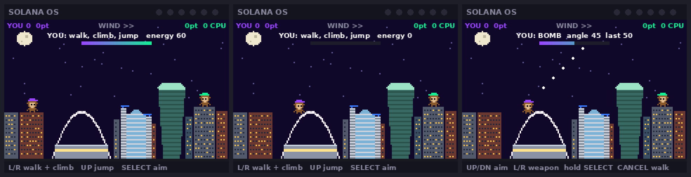
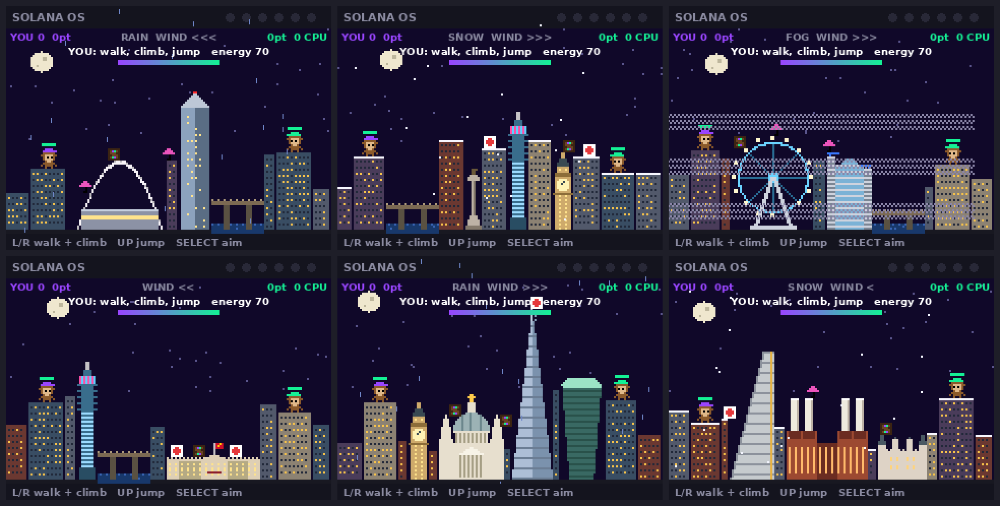

# Solana OS games

Games for the **Solana OS** badge (the Breakpoint 2026 conference badge: a
320 × 240 screen, a d-pad with SELECT and CANCEL, and 8 LEDs). Badge apps are
small **Lua** programs. Each game is a folder you upload at the badge site's
`/apps/submit` page. The format is documented in
[LUA_API.md](https://github.com/solana-foundation/solana-os/blob/main/docs/LUA_API.md).

| Game | Folder | Status |
|---|---|---|
| Solana Pong | [`pong/`](pong/) | Playable (tested in the local simulator) |
| Solana Monkey Bomb (SMB) | [`monkey-bomb/`](monkey-bomb/) | Playable (tested in the local simulator) |

## Solana Pong

- **The ball** is the Solana mark, spinning like a coin (it spins faster as the ball speeds up).
- **The paddles** are bars of the "S": you play the **bottom bar** (left), and the CPU plays the **top bar** (right).
- **The net** is a column of small copies of the S's **middle bar**.
- **1 player:** play the CPU on Easy, Normal or Hard.
- **2 players:** play a friend on **another badge nearby**, over the badges'
  built-in radio (the "mesh"). Both pick *2 players: 2 badges*, one invites the
  other from the list, and the other accepts. Each player sees themselves on
  the left.
- First to 7 wins. Wins are saved on the badge.
- The badge's LEDs flash purple or green on each hit and sweep across when someone scores.

**Controls:** UP/DOWN moves your paddle. SELECT pauses (vs. CPU only). CANCEL
returns to the menu, and CANCEL on the menu exits.

### How the two-badge mode stays in sync

The radio allows only 4 short messages a second, which is too few to stream
the ball's position. So:

- **Each badge decides hits and misses on its own paddle**, using its exact
  paddle position. Lag can never cost a player a point.
- **The ball's flight is predictable.** It moves in straight lines and bounces
  off the walls the same way on both badges. So when someone hits the ball,
  their badge sends one message: where the ball left from, at what speed, and
  how long ago. The other badge works out the rest.
- **Every message repeats the latest ball state and the score.** A lost
  message is repaired by the next one.
- Badges far apart can also connect through a server "bridge", but that adds
  1–3 seconds of delay, which is too slow for Pong. The lobby marks those
  players as "far: laggy".

To test it without two badges, open the badge site's `/emulator` and
`/emulator?badge=2` in two tabs of the same browser, side by side, and run the
game in both.

### Files

| File | What it is |
|---|---|
| `pong/main.lua` | The game. |
| `pong/art.lua` | The pixel art (ball, paddles, net, title logo). It is generated: don't edit it by hand. |
| `pong/app.json` | The manifest: name, icon, colour, and permissions (`led` for the lights, `mesh` for two-badge games). |

Everything in `pong/` ships to the badge, so keep only game files there.

## Solana Monkey Bomb (SMB)

A turn-based throwing game over London, with a nod to the SMB community.

- **Two monkeys** on rooftops: player 1 in a **purple** cap, player 2 in a
  **green** cap (the Solana colours). The monkeys are original pixel art.
- **A new London skyline every round.** It mixes 3–5 landmarks from 20, with
  office blocks between them: the Shard, the Gherkin, the Cheesegrater, the
  Walkie-Talkie, Big Ben, the London Eye, Buckingham Palace, Westminster
  Abbey, Tower Bridge, St Paul's, the BT Tower, the Tower of London, Canary
  Wharf, Battersea Power Station, Nelson's Column, the O2, Wembley,
  Lloyd's, Olympia and Somerset House. At most one very wide landmark (the
  Palace, Tower Bridge, the O2, Wembley or Somerset House) appears per round. Some have see-through parts that bombs fly
  through, such as the inside of the London Eye and the space under Tower
  Bridge.
- **Move around before you throw.** Each turn starts in walk mode with an
  energy bar. Walk along rooftops, drop into the gaps, and **climb** any wall
  by walking into it (climbing costs double energy). Monkeys **cling** to a
  wall they've climbed, so you can throw from the side of the Shard. **Jump**
  to cross gaps. Your monkey throws the way it last faced, so you can climb
  past your opponent and throw back at them. When you're in a good spot,
  press SELECT to aim.
- **The CPU monkey moves too.** Each turn it scouts as far as its energy
  goes both ways and walks to the best spot it finds: higher ground, a wall
  between it and you for cover, and pickups (especially health when it's
  hurt). Hard picks the best spot; Easy wanders more randomly.
- **Destructible:** every explosion blows a hole in the skyline. A monkey
  whose roof (or wall) is blown away falls to the next solid surface.
- **Health:** each monkey has 100 health, shown as a bar over its head.
  Explosions do the most damage at their centre and about 40% at the edge.
  A monkey at 0 health loses the round, and blowing yourself up counts too.
- **The River Thames** runs through the city in about half the rounds, with
  a bridge over it (London, Waterloo, Blackfriars or Millennium Bridge) that
  you can walk on and blow up. A monkey that falls or walks into the river
  drowns and loses the round. Throws that land in the water just splash.
- **Weather** changes every round, shown next to the wind:

  | Weather | Effect |
  |---|---|
  | Clear | None |
  | Rain | Throws are heavier and drop sooner |
  | Snow | Snow on the roofs, and walking or climbing costs extra energy |
  | Fog | Drifting fog banks hide parts of the city, and the aiming guide shows only its first two dots |

- **Pickups** lie on the rooftops, 3 per round. Walk into one to take it:

  | Pickup | Effect |
  |---|---|
  | Health pack | +35 health (up to 100) |
  | Umbrella | Blocks the next explosion that would hurt you. Shown over your head while you carry it |
  | Crate | +1 ammo for a special weapon |

  Pickups caught in a blast are destroyed, and ones whose roof is blown
  away fall (or sink in the Thames).
- **Wind** changes every round and pushes throws sideways (shown at the top).
- **Weapons**, each player per round:

  | Weapon | Ammo | Damage at the centre | What it does |
  |---|---|---|---|
  | Bomb | unlimited | 40 | The standard throw. |
  | Banana bunch | 2 | 15, then 18 per banana | Bursts on impact into 5 bananas that scatter and explode. A cluster bomb. |
  | Bazooka | 3 | 45 | Fast and flat, hardly drops, but drifts more in the wind. |
  | Coconut | 1 | 65 | Heavy, with a huge blast. |

- **Points for damage.** Every pixel destroyed scores: 1 for an office block,
  and 1–3 for a landmark depending on how iconic it is. Knocking out more
  than half a building earns a bonus: +20 for a block, and +100 to +300 for a
  landmark, announced on screen (e.g. "BIG BEN DESTROYED!"). Damaging the
  other monkey scores 2 points per point of health, and knocking it out
  earns +250 and wins the round. First to win **3 rounds** wins
  the match. Points are a bonus score: the best total is saved on the badge.
- **Modes:** 1 player against a CPU monkey (Easy or Hard, and it uses the
  weapons too), **pass the badge** (2 players on one badge), or **2 badges**
  over the radio. Because the game is turn-based, 2-badge games also work
  between badges far apart through a server "bridge".

**Controls:**

| | Walk mode (start of each turn) | Aim mode |
|---|---|---|
| LEFT/RIGHT | Walk, and climb when against a wall | Switch weapon |
| UP | Jump | Aim higher |
| DOWN | | Aim lower |
| SELECT | Switch to aim mode | **Hold** to fill the power meter, let go to throw |
| CANCEL | Back to the menu | Back to walk mode |

On older badge software that can't detect a button being held down or let
go, each LEFT/RIGHT press takes one step. You also press SELECT once to start
the power meter and again to throw.

**How two badges stay in sync:** both badges build the skyline from the same
**seed**, a starting number for all the random choices. A throw is sent as
just its angle, power and weapon, plus where the thrower is standing and
which pickups they collected on the way (under 90 bytes). The weather, the
river and where the pickups lie all come from the round's seed. A monkey
that walks into the Thames sends a "throw" with no weapon, so both badges
end the turn the same way. While a player walks, their badge also sends their position a few
times a second, so the other player can watch them move. Each badge then flies it
with the same fixed-step physics, so the flight, the holes, the points and
the result are identical on both. Each throw is resent until the other badge
confirms it, so lost messages are fine.

| File | What it is |
|---|---|
| `monkey-bomb/main.lua` | The game: weapons, physics, points, CPU, menus and the two-badge mode. |
| `monkey-bomb/skyline.lua` | The London skyline: every landmark's drawing, the Thames and its bridges, snow on the roofs, the round's weather, and how a city is put together. To add a landmark, add one entry here. |
| `monkey-bomb/app.json` | The manifest (`led` for the lights, `mesh` for two-badge games). |

## Try a game on a real badge or the emulator

1. Open the badge site's `/apps/submit` page and drop in the game's folder
   (`pong/` or `monkey-bomb/`).
2. Click **Try in emulator** to play it in the browser, or **Run on badge** to
   copy it to a badge over USB (desktop Chrome or Edge).
3. **Publish** when you're happy. Publishing needs an account with X linked.

## Developer tools (`tools/`)

These run on a computer, not on the badge.

- `python3 tools/gen_art.py` rebuilds `pong/art.lua` from the official Solana logo shape.
- `python3 tools/test_pong.py` plays three full matches automatically. It checks
  for errors, pause, menu and exit, and that the game stays far below the
  badge's per-step CPU limit.
- `python3 tools/test_pong_duo.py` plays a two-badge match between two
  simulated badges, with 15% of messages dropped on purpose. It checks that
  both agree on the score, the screens stay in sync, and no badge goes over 4
  messages a second.
- `python3 tools/test_monkey_bomb.py` plays Monkey Bomb against the CPU on
  both levels, a pass-the-badge match, and a two-badge match with 20% of
  messages dropped, with every weapon in play and the players walking,
  climbing and jumping. It checks that both badges' skylines stay
  pixel-for-pixel identical with the monkeys in the same places, that both
  agree on rounds and points, and that every step stays well under the
  badge's CPU limit.
- `python3 tools/sim.py pong <folder>` saves screenshots from a rough stand-in for the badge.

The tools need `pip install lupa pillow`. The stand-in badge only approximates
the real one, so always check in the official emulator too.
