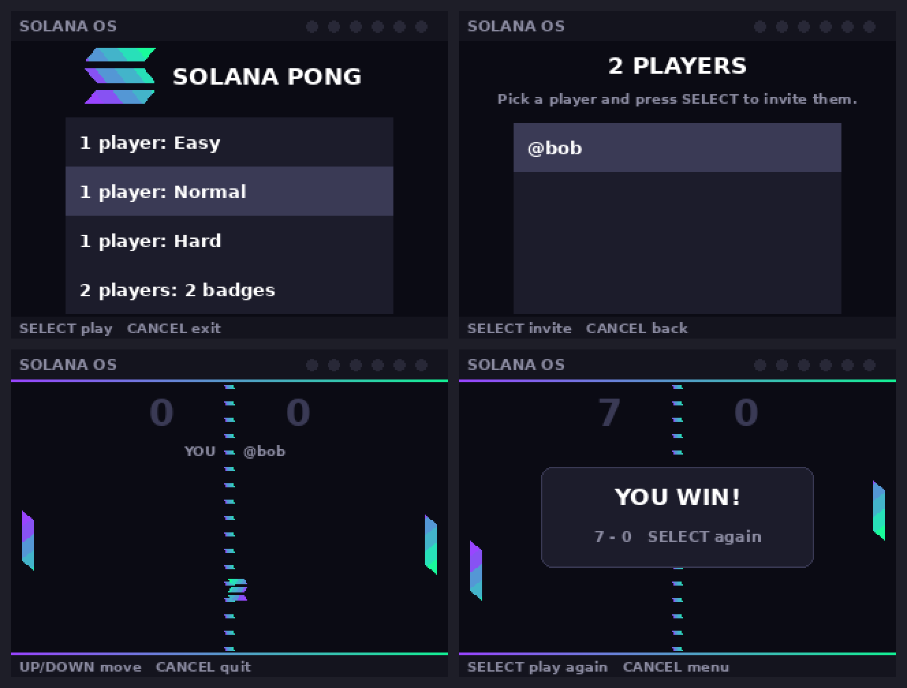
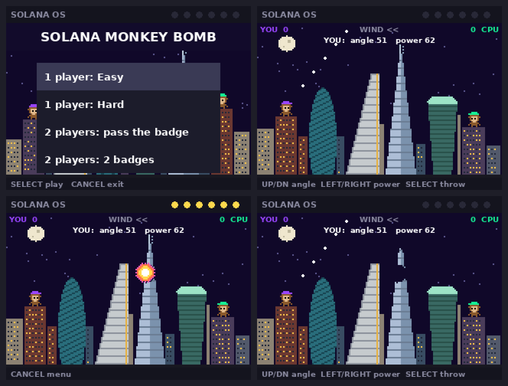

# Solana OS games

Games for the **Solana OS** badge (the Breakpoint 2026 conference badge: a
320 × 240 screen, a d-pad with SELECT and CANCEL, and 8 LEDs). Badge apps are
small **Lua** programs. Each game is a folder you upload at the badge site's
`/apps/submit` page. The format is documented in
[LUA_API.md](https://github.com/solana-foundation/solana-os/blob/main/docs/LUA_API.md).

| Game | Folder | Status |
|---|---|---|
| Solana Pong | [`pong/`](pong/) | Playable (tested in the local simulator) |
| Solana Monkey Bomb (SMB) | [`monkey-bomb/`](monkey-bomb/) | Playable (tested in the local simulator) |

## Solana Pong

- **The ball** is the Solana mark, spinning like a coin (it spins faster as the ball speeds up).
- **The paddles** are bars of the "S": you play the **bottom bar** (left), and the CPU plays the **top bar** (right).
- **The net** is a column of small copies of the S's **middle bar**.
- **1 player:** play the CPU on Easy, Normal or Hard.
- **2 players:** play a friend on **another badge nearby**, over the badges'
  built-in radio (the "mesh"). Both pick *2 players: 2 badges*, one invites the
  other from the list, and the other accepts. Each player sees themselves on
  the left.
- First to 7 wins. Wins are saved on the badge.
- The badge's LEDs flash purple or green on each hit and sweep across when someone scores.

**Controls:** UP/DOWN moves your paddle. SELECT pauses (vs. CPU only). CANCEL
returns to the menu, and CANCEL on the menu exits.

### How the two-badge mode stays in sync

The radio allows only 4 short messages a second, which is too few to stream
the ball's position. So:

- **Each badge decides hits and misses on its own paddle**, using its exact
  paddle position. Lag can never cost a player a point.
- **The ball's flight is predictable.** It moves in straight lines and bounces
  off the walls the same way on both badges. So when someone hits the ball,
  their badge sends one message: where the ball left from, at what speed, and
  how long ago. The other badge works out the rest.
- **Every message repeats the latest ball state and the score.** A lost
  message is repaired by the next one.
- Badges far apart can also connect through a server "bridge", but that adds
  1–3 seconds of delay, which is too slow for Pong. The lobby marks those
  players as "far: laggy".

To test it without two badges, open the badge site's `/emulator` and
`/emulator?badge=2` in two tabs of the same browser, side by side, and run the
game in both.

### Files

| File | What it is |
|---|---|
| `pong/main.lua` | The game. |
| `pong/art.lua` | The pixel art (ball, paddles, net, title logo). It is generated: don't edit it by hand. |
| `pong/app.json` | The manifest: name, icon, colour, and permissions (`led` for the lights, `mesh` for two-badge games). |

Everything in `pong/` ships to the badge, so keep only game files there.

## Solana Monkey Bomb (SMB)

A turn-based throwing game over the City of London's skyline, with a nod to
the SMB community.

- **Two monkeys** on rooftops: player 1 in a **purple** cap, player 2 in a
  **green** cap (the Solana colours). The monkeys are original pixel art.
- **The skyline** is rebuilt every round, mixing **the Shard**, **the
  Gherkin**, **the Cheesegrater** and **the Walkie-Talkie** with ordinary
  office blocks with lit windows. Bombs blow holes in the buildings.
- **Wind** changes every round and pushes the bomb sideways (shown at the top).
- **1 player** against a CPU monkey on Easy or Hard. It plans its throw and
  gets more accurate after each miss.
- **2 players: pass the badge.** Take turns on one badge.
- **2 players: 2 badges.** Play over the badges' radio, invite and accept as
  in Pong. Because the game is turn-based, it also works between badges far
  apart through a server "bridge".
- First to win **3 rounds** wins the match. Match wins are saved on the badge.

**Controls:** UP/DOWN sets the angle, LEFT/RIGHT sets the power (hold to go
faster), and SELECT throws. CANCEL goes back to the menu.

**How two badges stay in sync:** both badges build the skyline from the same
**seed**, a starting number for all the random choices. A throw is sent as
just its angle and power (under 50 bytes). Each badge then flies the bomb with
the same fixed-step physics, so the flight, the hole and the result are
identical on both. Each throw is resent until the other badge confirms it,
so lost messages are fine.

| File | What it is |
|---|---|
| `monkey-bomb/main.lua` | The whole game, including the pixel art and the skyline drawing. |
| `monkey-bomb/app.json` | The manifest (`led` for the lights, `mesh` for two-badge games). |

## Try a game on a real badge or the emulator

1. Open the badge site's `/apps/submit` page and drop in the game's folder
   (`pong/` or `monkey-bomb/`).
2. Click **Try in emulator** to play it in the browser, or **Run on badge** to
   copy it to a badge over USB (desktop Chrome or Edge).
3. **Publish** when you're happy. Publishing needs an account with X linked.

## Developer tools (`tools/`)

These run on a computer, not on the badge.

- `python3 tools/gen_art.py` rebuilds `pong/art.lua` from the official Solana logo shape.
- `python3 tools/test_pong.py` plays three full matches automatically. It checks
  for errors, pause, menu and exit, and that the game stays far below the
  badge's per-step CPU limit.
- `python3 tools/test_pong_duo.py` plays a two-badge match between two
  simulated badges, with 15% of messages dropped on purpose. It checks that
  both agree on the score, the screens stay in sync, and no badge goes over 4
  messages a second.
- `python3 tools/test_monkey_bomb.py` plays Monkey Bomb against the CPU on
  both levels, a pass-the-badge match, and a two-badge match with 20% of
  messages dropped. It checks that both badges' skylines stay
  pixel-for-pixel identical and that every step stays well under the
  badge's CPU limit.
- `python3 tools/sim.py pong <folder>` saves screenshots from a rough stand-in for the badge.

The tools need `pip install lupa pillow`. The stand-in badge only approximates
the real one, so always check in the official emulator too.
